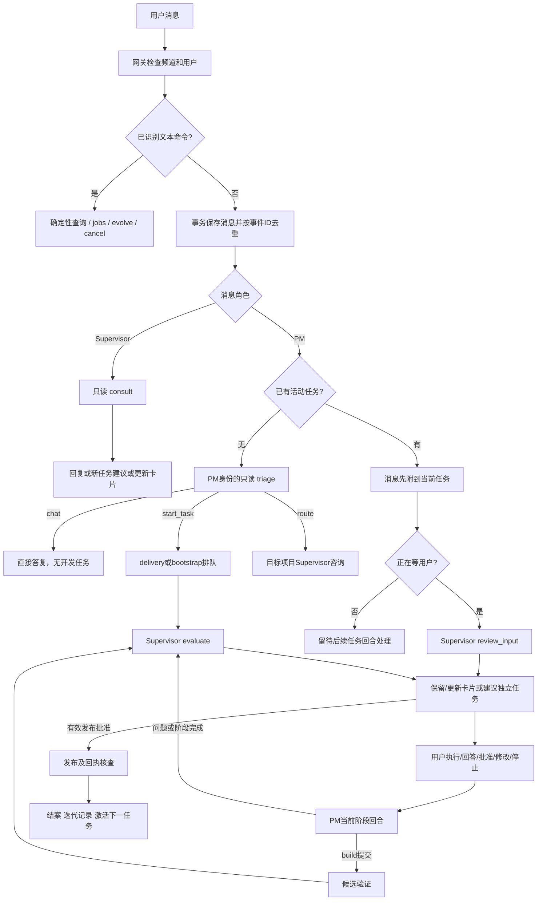
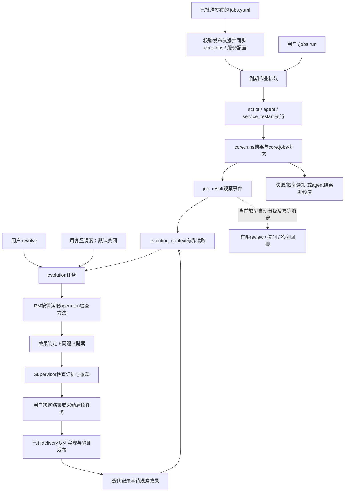
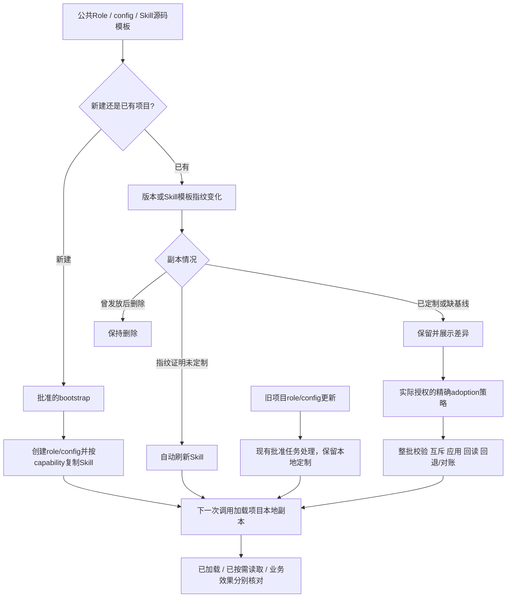

# Kernel operation 日常运营逻辑、协作流程与闭环审查

审查日期：2026-11-16（用户本地日期）。审查性质：当前源码只读分析、三条独立上下文交叉检查、局部纯文本/编译验证；不是生产验收或全面回归。本轮不修改源码、模板、配置、数据库或业务状态。

## 1. 当前结论与基线

**原任务书要求的完整日常运营职能尚未全部落地。** 当前具备已发布作业/服务运行、空闲时轻量问答、正式/quick 交付、手动复盘、运行观察记录、历史读取和模板更新机制；但“任何状态下统一运营受理 → 有限处理 → 事件分级 review → 问题答复回接 → 执行/恢复 → 结案”的整条公共链尚未成立。

- 实际 Git 根：`H:/AI/assistant-kernel`；当前分支 `main`，HEAD `0b395e7`（feat: add host execution foundation and improve task traceability）。不能沿用交接端“共用 H:/AI Git 根”的历史描述。
- 工作区有大量已修改和未跟踪文件，包含 CoS、Project Access 等其他改动。审查对象是当前工作区，不是纯 HEAD，也不能将全部差异归为本对话实施。
- 版本文件声明 `0.46.3`、schema `core6.0013`；目录另有 `0014_chief_of_staff.sql`。这只是版本标识与迁移文件清点，未核实任何部署库实际应用状态和校验值，不据此认定数据库不一致。
- 需求基线：本对话上传的公共运营集成任务书，特别是统一受理、明确授权、幂等/取消/版本/恢复、两类项目、模板采纳和六项完成状态。
- 未读取真实运行项目 Vault、生产环境变量、生产数据库、实际队列或模型调用日志；未重跑 PostgreSQL/Linux 回归。之前测试记录不等于本快照验收。
- 隔离候选及其历史设计不作为本轮已实现证据；本轮以目标仓库实际注册、调用和合同为准。

分层判定：

| 层面 | 判定 | 解释 |
|---|---|---|
| 完整公共日常运营目标 | 未通过 | 有确定的入口、事件消费、档案和授权执行缺口 |
| 既有作业运行和交付机制 | 部分对齐，运行验收未验证 | 源码主链存在，但暂停、未知结果与重试边界仍需完善 |
| PM/Supervisor 协作 | 部分对齐 | 任务协作已有；任务忙时分流和事件 review 未闭环 |
| 新项目模板 | 具备分发代码 | 角色/Skill能创建，但不是运营写权限已授权 |
| 旧项目迁移 | 部分对齐 | Skill有指纹同步和显式 adoption；role/config不由同一批次自动迁移 |
| 生产生效 | 未验证 | 本轮未部署，也未核实生产当前状态 |

登记16项发现：P0 0项、P1 9项、P2 7项。P0为0只表示本轮未登记确定的P0问题，不是安全保证。P1/P2按本报告风险等级，与原任务书P1–P5实施批次编号无关。

## 2. operation、operate、evolution 的真实关系

1. **业务上的日常运营**：持续查询、生产、素材、维护、历史检索、反馈、异常恢复。这是用户要求的能力集合。
2. **代码阶段 `operate`**：当前是 `evolution` 任务的起始/自循环阶段，不是所有项目交付后的常驻任务。`rules.py:102–120`。
3. **Skill `assistant-operation`**：版本3.6.0，PM在 `evolution` 时按需发现/读取的只读运营健康检查方法。其输出并入 `improvement_proposal`，不执行recipe、不改业务文件、不重跑job、不重启服务。`assistant-operation/SKILL.md:24–37,75–85`。
4. **实际生产**：已发布 `jobs.yaml` 注册为 job/service，Dispatcher执行。它与复盘任务相互独立，正常生产不反复经过五阶段。
5. **`host_operations`**：PC端受控只读查询，具有自己的设备策略和结果记录，不是新的日常运营任务，也不是执行型小改入口。

因此，“存在 operation Skill”“role.md 写了日常运营职责”和“日常运营完整落地”是不同事实。不存在独立 operation task 本身不是缺陷，缺的是业务义务没有被已有机制完整承接。

## 3. 用户入口与分流规则

| 输入/条件 | 当前执行 | 接收者及结束方式 | 限制 |
|---|---|---|---|
| `/status`、`/pending`、`/iterations`、`/models` | 网关确定性查询 | 直接回复 | 不需要先调用管理模型 |
| 空闲项目PM普通消息 | 持久化后排triage | chat直接答复；start_task建任务；route转其他项目咨询 | triage自身是一次只读模型调用 |
| 项目有活动任务，PM发消息 | 先关联该任务 | awaiting_user时另排review_input；其他状态待后续回合消费 | 独立需求和普通查询未先统一分类 |
| Supervisor频道消息 | 单独consult run，携当前任务上下文 | 直接回复，或建议新任务/改卡/授权申请 | 不自动成为PM输入；新任务仍需卡片批准 |
| 用户回答卡片 | item_id、动作和必填校验，记录回答 | 给PM答案或让Supervisor重新评估 | 旧卡被替换后按钮过期 |
| `/evolve` | 建有限evolution任务 | PM复盘→Supervisor→结束或follow-up | 不受周复盘调度开关约束 |
| `/jobs pause/resume/run` | 确定性修改job状态或排队 | 命令回复、run及事件记录 | run可对paused job手动排队；暂停不撤回旧run |
| 产品job完成/失败 | 保存run结果、job状态、job_result事件 | 告警/结果发频道，供下次复盘读 | 发到Supervisor频道不等于启动Supervisor模型 |
| 素材、用户反馈 | 作为消息/已有任务材料处理 | 依赖对话与交付流程 | 未形成通用内容档案和check_id反馈闭环 |

消息去重：`Kernel.receive`在同一事务中保存消息并路由，唯一键是 `(channel,external_event_id)`。无external_event_id的调用不具有这一去重保证。项目锁保护该次路由。文本命令走另一路径，`/evolve`传了消息幂等键，但`/jobs run`没有复用这个消息ID。

## 4. 流程图一：当前消息受理与PM/Supervisor协作

图中是现状，未画成“自然语言请求必定直接完成”。triage结果落地时若已有delivery，当前实现还会把第二个start_task视为补充（machine.py:793–799）；这不能证明两个独立需求被正确拆分。

## 5. PM、Supervisor、Kernel 的具体分工

| 主体 | 责任 | 能做的事 | 不能据此宣称 |
|---|---|---|---|
| PM/triage | 轻量理解、查询、提出建任务或路由 | 只读查证后回复 | 已实现业务修改 |
| PM/任务 | 本阶段实现与文档，维护working_notes和来源 | build内候选文件或代码工作树；其他阶段只读业务文件、可编辑允许的任务文档 | 回合completed不等于任务完成 |
| PM/evolution | 核对效果与业务运行，归因和提案 | improvement_proposal、working_notes | 提案不等于批准、执行或恢复 |
| Supervisor/evaluate | 范围、阶段、证据、返工与下一步 | 提卡片；转达PM问题；建议quick/full | 无权自行实现、批准或跳过门禁 |
| Supervisor/review_input | 用户在等待卡时发补充 | 保留/更新卡、新任务建议、明确偏好记录 | 新任务建议不等于已经排入独立执行 |
| Supervisor/consult | 独立只读咨询 | 回答、建议任务、申请权限或更新卡 | 消息不自动送给PM |
| machine/Kernel | 状态权威、审批、run、幂等、结案 | 事务校验、排队、拒绝旧状态结果 | 不能证明外部副作用已经撤回 |
| Dispatcher/运行时 | job/service调度、执行、租约恢复和文件同步 | 调用确定性执行器，按配置维护 | 进程退出码0不证明业务产物有效 |
| 用户/维护者 | 必要决策、权限、发布与实际故障处置 | 通过现有卡片/策略/维护流程 | 不因模板已安装而自动授权全部写操作 |

工具权限取交集：执行器提供集合 ∩（Agent配置集合 ∪ 平台工具）。Supervisor的`tools: []`意味着平台工具仍可用，不是完全无工具。平台提供历史、map、凭证、Skill更新状态等；跨项目工具还受Project Access开关和策略控制。`host_submit`可排只读设备查询，所以“只读”不等于“不写任何队列或审计记录”。

PM非build使用只读sandbox；build当前使用danger-full-access并依赖候选/工作树及范围约束。这不能作为P2受限recipe隔离已通过的证据。

## 6. 任务、批准、问题答复与恢复规则

- 每项目一个活动开发/复盘任务，其余排队；活动任务一个当前cursor（run或卡片），一个项目一张交互卡，可含多个事项。
- full：requirements→design→build→review→release；quick：requirements→build→release。quick省设计和独立review，仍保留需求批准、当前候选验证和发布批准。
- Supervisor选择大小的Skill依据是小、明确、低风险 versus 多模块、广影响等；尚未形成原要求中“范围、权限、版本、可逆性、验收”完整的执行型小改策略。
- 审批绑定文档/候选哈希，文档改变导致原批准无效；完整review绑定需求、设计、实现、验证与bundle。不能伪造旧approval。
- PM每次claim固定本轮输入，晚到输入不应被本轮冒认已读。Supervisor evaluate期间有新输入则重新评估；review_input核对旧item_id并检查运行期间新消息。
- PM问题一般经Supervisor整理再给用户；凭证问题直接走凭证卡和专用存储，不应写入普通文档。
- PM换阶段或原生session达到8回合后换session；交接依赖任务ledger、working_notes和文档，不依赖模型记忆。
- 任务结束撤queued run、标记运行run取消、移除卡、记录iteration并激活下一任务。未消费PM输入会有限提醒，不自动创建独立需求。
- 等待用户约7天且项目无新入站消息时自动结束，发布停止证明不足则不解除阻塞。它不是每个问题独立的SLA；任意项目入站可影响闲置判定。
- 默认租约900秒；Dispatcher约租约三分之一做心跳。恢复扫描先列候选，再锁后复核过期，避免把已续租run误恢复。
- 普通run可按attempt退避重试；publish未知进入reconcile，不盲重发。普通job尚未享有同等的外部效果未知保护。
- `/cancel`不等于回滚副作用；发布中有专门限制，停止证明和实际目标核验仍然必要。

## 7. 流程图二：作业、观察、复盘与反馈

虚线是缺口，不能当已实现。`notify`只写outbound；频道里出现Supervisor通知不会自动触发consult。

作业的具体条件：

- 文件交付：manifest需与发布事件哈希一致；代码交付读取配置main分支的manifest。普通文件消失不能被当作已批准删除。
- 新job注册默认enabled；已有job更新保留状态；retired同名重新出现会走重新enabled分支。后者是否符合业务hold意图应明确。
- 到期多期错过只补一次；同project/job处于queued/running/reconciling时跳过本次并推进next_at。
- script执行在项目vault或代码仓库，精简环境和超时，日志留在vault；agent job只读且以最后文本作为结果；service_restart只重启对应项目服务。
- script超时/取消终止POSIX进程组，容忍进程已退出。不能证明脱离进程组、远程写入、网络外部效果或数据库断联期间的旧writer已停止。
- 成功观察摘要最多500字符，完整结果在run、日志在文件；失败耗尽有错误观察。当前观察不是有消费cursor和处理终态的运营事项。
- 服务last_at表示状态变化时间；job last_at表示结果时间；observed_at表示查询时刻。均不能单独代表业务健康。
- 周复盘生产入口缺省关闭，job维护缺省开启；关闭周复盘不撤销已排队/运行的复盘，也不关闭租约、队列、vault或服务维护。
- 启用周复盘后，当前条件含周日上海时间13点起24小时补偿窗、active/ready、排除CoS、项目weekly_evolution非false、周幂等键、无未结束复盘、近期活动或待观察效果。
- 环境开关当前按字符串是否等于`0`判断，`false`不会关闭。生产实际取值未查。

## 8. operation 健康检查的完整业务清单

operation Skill的方法规则如下，属于提示方法；不是已运行的自动验收器：

1. 先确定生效章程、实际产品、发布版本和原验收。最新一次增量任务不等于整个项目，人工交付也需查真实证据。
2. job区分enabled、paused、retired、未到期、逾期、未知；核对日志和实际产物，不凭“没记录”断言失败。
3. 服务区分注册、进程状态变化和真正健康；旧last_at不表示故障，缺活体证据须标未验证。
4. 按业务周期核对产出时效、完整性、位置、接收证明、引用输入；风险抽样要声明范围。
5. 核对输出是否被使用、用户反馈和反复投诉；不因没有job就认为没有运营义务。
6. 核对map/charter/实际目录与jobs.yaml；注意临时区持久数据、半成品、引用失效、增长/保留约定。
7. 发现项记录对象版本、触发、影响、证据、已知实际效果、下一步和恢复条件，交给复盘F/P。
8. 不自行清理、迁移、设置保留周期、重跑、重启或修改产品。修复验证、运行恢复和业务效果分别报告。
9. CoS只检查自身输出；观察其他项目经Project Access，不能因此取得操作权。

通用内容档案当前缺失：迭代流、任务文档版本及历史分页是已存在的相邻机制，但不能替代内容identity/不可变版本、原文可验证性、摘要来源、比较报告候选哈希与代次、覆盖与截断、精确check_id反馈五件套。素材收集仍缺统一公共接收和归档闭环。

## 9. Skill、合同与加载条件

以下版本是源码模板版本，不是运行中项目已采纳版本。所有`assistant-`前缀均保留在实际文件名中。

| Skill | 版本 | 选择条件 | 业务责任 |
|---|---|---|---|
| assistant-operation | 3.6.0 | PM，evolution，按需 | 运营健康事实检查，输出进入复盘 |
| assistant-evolution-review | 2.5.0 | PM，evolution，全文 | 效果复核→F归因→最多5个P→follow-up |
| assistant-goal-supervisor | 6.13.0 | Supervisor常驻 | 范围、阶段、证据、提问与返工 |
| assistant-triage-routing | 1.2.0 | PM/Supervisor，triage或consult | 查询、项目工作、路由；正文尚未细化描述中的事故/维护路径 |
| assistant-task-continuity | 2.16.0 | PM/Supervisor常驻 | 文档合同、ledger、working_notes、来源/恢复交接 |
| assistant-history-retrieval | 1.4.0 | PM/Supervisor，按需 | 原话/批准查证，跨项目权限、分页覆盖 |
| assistant-capability-maintenance | 2.8.0 | PM，build或evolution | Skill/角色改进与采纳方法；复盘仅提案 |
| assistant-project-agent | 2.3.0 | PM各任务阶段 | PM职责与本轮界限 |
| assistant-source-scope | 4.3.0 | PM常驻 | 授权目录与工作区边界 |
| assistant-user-questions | 1.2.0 | PM/Supervisor常驻 | 问题组织与用户答复 |
| assistant-user-insight | 1.3.0 | PM/Supervisor常驻 | 明确偏好、事实/推断区分 |
| assistant-credentials | 1.1.0 | PM/Supervisor按需 | 凭证使用与请求边界 |
| assistant-subagent-orchestration | 2.7.0 | PM requirements/design/build/review/evolution | 按收益分工，保留主责任 |
| assistant-kernel-maintenance | 1.3.0 | kernel_maintenance能力，相关阶段或evaluate | Kernel自身公共改进，不等同业务操作权 |

转入正式修改时另用：requirements 3.3.1、solution-design 2.5.0、implementation 2.5.0、release-audit 2.3.0；git-delivery 1.1.0仅git_delivery能力且build/review。按需求发现的设计技能包括agent-design 2.2.0、mcp-design 1.4.0、project-structure 1.3.0、workflow-design 2.2.0、domain-research 1.2.0。另有project-chartering 1.3.0、shared-context 1.2.0和volcengine-models 1.2.0，按创建任务/能力/阶段适用。共清点27个模板的版本和load元数据；未把所有27个的正文逐条审计算作已完成。

加载硬规则：roles、capabilities、task_kinds必须同时匹配；stage或purpose任一匹配即可；disabled排除；无stage/purpose限制则默认匹配。evolution的实际stage虽是operate，PM加载前会映射为evolution。

常驻方法全文注入；按需方法不代表已读全文。在原生Agent目录中还存在原生Skill发现，不能把Kernel的load选择误认为独立文件权限边界。运行结果skills标签包含按需选择项，标签出现只证明选择/可发现，不证明遵循。

真实解析合同：triage.md、supervisor-evaluate.md、supervisor-review-input.md、supervisor-consult.md、pm-output.md，以及runtime-manifest.md和相关交付合同。当前未找到独立pm-operate合同，PM复盘复用pm-output。必须同步改解析器和machine才能添加新决策，不能只改Skill。

模型配置已有profile选择与字段覆盖；当前代码按Agent显式profile→角色default→全局default选择一个profile，再按Agent显式字段→所选profile字段→环境默认取值。未见simple/standard/complex运营复杂度路由。PM/triage当前prompt先含动态项目上下文，不能认定已实现固定公共合同前缀。哈希和usage记录不代表供应商缓存命中。

## 10. 流程图三：新旧项目模板分发与采用

- 新项目bootstrap只写不存在的模板文件，配置和章程按批准spec建立；模板不授予自动执行recipe权限。
- 未改Skill指纹刷新与显式adoption是两条现有路径。不能笼统说“旧项目未采纳时任何行为都不变”：自动刷新会改变未定制副本。
- 显式adoption要求真实authorization_ref、固定包hash、准确选择集合，支持定制差异、完整目录快照、回退和中断对账；默认无策略不执行。
- 显式adoption阻止新claim并检查运行状态；自动refresh路径目前没有等价的活跃run/任务栅栏，需补齐。
- 普通Skill同步不负责旧role.md/config.yaml，因此新模板中的日常运营职责未必到达旧项目。
- 文档SKILL_ADOPTION开头写未改副本自动刷新，45行却写不再随版本覆盖，表述冲突；角色中已消除“只能周复盘更新”，部分Skill正文/注释仍以周复盘表述定制采纳入口。

## 11. 16项发现、触发场景与最小完善方案

| ID / 等级 | 事实与场景 | 后果 / 分类 | 最小完善与验收 |
|---|---|---|---|
| OP-01 P1 | 活动任务时新PM消息先附着；两条idle triage中第二条见delivery已存在也改附着 | 独立需求可能误作补充；常规查询不能始终轻量。实现缺口 | 在现有receive/triage关联中保留逐message判定；补充与独立项分开，不新造任务平台。验证任务各状态+双消息并发+独立排队 |
| OP-02 P1 | job_result只写事件并供复盘读取，没有info/review/urgent消费、问题关联与补偿排队 | 周复盘关闭后事故可能只有通知，无明确处理责任。实现缺口 | 复用task_events/runs/cards建立同项目可信来源、有限review幂等键与未消费扫描；验证事件→问题→答复→PM→结案，普通info不调用模型 |
| OP-03 P1 | outbox先send后mark_delivered，transport无发送幂等标识/未知结果对账 | 外部已送达但本地未记账时可重复发送。可触发实现缺口 | 在现有outbox保存发送身份与未知状态，按平台能力核对；不能保证查明时明确人工对账。故障注入成功发送后断联，不盲重发 |
| OP-04 P1 | /jobs pause只改job状态；claim/execute未重查job暂停、退役、manifest版本或项目ready；完成用旧spec更新当前job | 旧排队/旧回调可能在暂停或版本变化后继续执行/覆盖。可触发实现缺口 | 明确暂停后在途策略，旧版本作废与允许完成的区别；claim/提交复核当前记录。测排队后暂停、退役、换版、项目归档 |
| OP-05 P1 | heartbeat数据库异常继续工作；recover对非publish允许重试，job无独立writer停止证明 | 外部动作已做/旧进程仍运行时可能重做。可触发实现缺口 | 有副作用job先进入结果未知对账；按动作真实幂等性选择恢复；复用run状态，不把killpg当远程停止证明。测DB分区、外部成功后写回失败 |
| OP-06 P1 | _held、通用Scope.check_lease和host authorize只看token/status，未比较当前lease_until；claim不统一检查项目当前状态 | 到期但扫描未处理时仍可能调用工具或提交。实现缺口 | 统一必要的时间/取消/项目/当前cursor校验；保留Project Access已有到期复核。测到期未扫描、取消后、策略变更后回调 |
| OP-07 P1 | /jobs run命令绕过receive消息去重，run_now未检查busy或命令请求键 | 同命令重投递会多排；mutex只串行执行，不去重。实现缺口 | 把外部消息身份传入既有run排队去重；明确用户不同run请求是否保留。测同事件重送与两次明确独立手动运行 |
| OP-08 P1 | _sync_templates直接文件刷新，只检查adoption的WRITING；未保护普通活动run；role/config不在此更新链 | 同回合常驻旧提示和按需新Skill可能混用；旧角色未更新。实现缺口 | 复用项目锁/现有批次约束，安全时点分发；role/config走现有维护任务与差异保护。测运行时刷新、定制保留、删除保留、回退 |
| OP-09 P1 | quick仍需卡片推进；未找到范围/版本绑定的小改授权执行策略 | 已明确小需求仍不能按原目标连续实现测试交付。设计/实现缺口 | 在已有quick/candidate/validation/release内使用本次有效授权，越界回正式流程；recipe隔离不达标继续阻塞。禁止以改提示绕门禁 |
| OP-10 P2 | 通用内容register/search/compare/report/feedback及check_id链未找到 | 素材、原文版本、摘要证据和精确反馈缺公共闭环。实现缺口（原任务强制项） | 复核候选后最小集成到已有服务/工具；验跨项目拒绝、改写原文、不同角度、截断覆盖、旧报告不能验新候选 |
| OP-11 P2 | 有model profiles，无复杂度路由及固定公共前缀的完整实现 | P5不能宣称完成，成本/缓存效果无证据。实现缺口（原任务强制项） | 复用models，定义明确优先级与无配置兼容；检查恢复session和所有入口；只据实际usage报缓存 |
| OP-12 P2 | 两项目新增测试的失败脚本文本编译出SyntaxError；预期观察数量前后冲突；项目隔离断言容许None | 不能作为本快照验收。测试缺陷/证据缺口 | 修复生成换行与三事件预期，断言外层project_id；再跑临时PG/Linux入口测试。禁止减弱断言来凑通过 |
| OP-13 P2 | 关闭周复盘只停新调度，旧排队/运行继续；字符串false视为开启 | 与用户理解可能不同。配置语义缺口 | 严格解析布尔，明确来源schedule/user和在途策略；只处理自动复盘，不停业务job/维护 |
| OP-14 P2 | map_lookup返回截断列表，无total/truncated标记或存在状态；operation靠提示核验 | 查询无结果/前20条容易误作完整证据。覆盖证据缺口 | 为现有接口补覆盖和遗漏提示，依赖map的写入前核对实际对象；保留验证器已有结构检查 |
| OP-15 P2 | review_input耗尽只记side_run_failed，不通知；闲置判定按项目任意入站 | 用户可能以为补充在处理；无关聊天可延长等待任务。失败反馈缺口 | 给既有卡补明确失败/恢复条件，保留原问题；任务相关活跃与项目聊天区分。测review_input失败和无关聊天持续 |
| OP-16 P2 | triage Skill描述说维护/事故，但正文主要仍是问答/建任务/路由；adoption文档有冲突；事件触发复盘措辞超前于接线 | 模板、代码与完成声明不自洽。合同/文档缺口 | 以真实能力同步角色、Skill、合同、文档；版本/changelog同改，新增能力须有解析器和入口验收 |

OP-04的“暂停”可以按产品约定仅影响未来调度，但当前没有覆盖原任务书所要求的强暂停/撤权旧回调约束，因此不能用现状替代该目标。OP-05未观察到生产重复外部动作，属于代码可触发路径，不报告为已发生事故。OP-10/11的等级较低不意味着原始强制需求可自动免除。

## 12. 建议增加的场景矩阵

| 场景 | 应验证的业务语义 |
|---|---|
| PM正在build，用户问进度又提出另一件需求 | 查询独立回答，新需求留独立记录，当前build不被偷换范围 |
| 两条独立请求几乎同时到达 | 分别持久化、分别判定，不因已有delivery就合并 |
| 旧PM回合返回问题，新答案已提前到达 | 不进入只能等再次回答的旧等待状态 |
| Supervisor评估期间持续新消息 | 不丢输入；评估重排不能无限饥饿；保留有限水位 |
| job发告警后普通用户文本回答 | 答复绑定确切事件/问题，不能靠“最近一条”猜关联 |
| 作业暂停后旧run才claim，或旧spec完成 | 按确定策略阻止/标注旧结果，不能覆盖当前有效版本 |
| job完成外部发送后数据库失联 | 记录未知并对账，不默认重跑 |
| 网关发送成功后记账失败 | 不重复通知/交付；卡片也需明确补偿 |
| 同一/jobs run事件重送与两次明确运行 | 前者去重，后者按规则保留，不能混为一谈 |
| 两个不同job同时写同一业务文件 | job级mutex不等于项目/资源写互斥，验证输出所有权与原子替换 |
| script退出0但未产出、产物半成品或错日期 | 不能报业务成功；按项目已有产物合同校验 |
| 旧项目定制role、删除Skill、已有hold | 分发不覆盖定制、不恢复主动删除、不扩权、不解除暂停 |
| 自动复盘关闭时已有自动/用户复盘和运行任务 | 各类策略分开，业务调度和健康检查保留 |
| 内容比较期间候选变更、档案增长、分页截断 | 旧比较报告失效或显示边界，反馈绑定原check_id |
| 原文被改写、只有摘要、无搜索结果 | 明确可验证程度和信息不足，不能判定“范围内不存在”之外的结论 |
| host查询已queued，当前模型回合结束 | 明确谁再poll结果，queued不是成功；不能混成recipe执行能力 |
| 项目归档/权限撤销/租约到期后旧工具与回调 | 当前策略再次生效，而不是只认旧上下文 |
| 多用户同频道、共享卡片 | 按部署用户允许列表明确谁能批准；空允许列表的开放语义需项目实际核查 |

其中共享文件写冲突、原生按需Skill读取、长期效果观察、真实生产用户权限本轮未做运行验证；不是都已证实有故障。

## 13. 最小完善顺序与验收

### 第一批：先修可靠性和证据

OP-03～08、12、15优先；统一消息命令幂等、租约/状态校验、暂停/版本语义、未知结果对账、自动模板刷新互斥。原始P2执行recipe继续禁用，不能把已发布脚本运行器当沙箱。

验收：临时数据库＋真实子进程/可控外部回执模拟；至少故障注入数据库断联、send后崩溃、旧回调和重复命令。单元/服务集成/真实入口证据分列。

### 第二批：把已有基础接成日常业务闭环

OP-01、02、09：受理保留逐事件身份；查询无开发任务；补充与独立任务明确；可信job事件按info/review/urgent进入有限处理，普通info只记账。复用现有run/card/task_events和维护扫描，不新增通用事件总线、并行状态平台或策略DSL。

验收：两个业务差异真实存在的隔离项目，使用同公共模板，跑消息→处理→观察→问题→答复→后续PM→结束；一类内容项目、一类非财经维护/报告项目。不能只改print字符串就称业务公共性通过。

### 第三批：补原始交付范围与模板一致性

OP-10、11、13、14、16以及旧role迁移：最小集成通用档案、模型路由、覆盖信息和角色采用说明。业务字段留扩展类型，不要求所有项目都包含视频字段。同步版本、changelog、map、i18n、迁移登记和验收报告。

不必做：新任务平台、向量数据库、模板发布器、自动发布平台、额度购买/重置、CLI自动升级。规模尚无证据前不扩成复杂全局调度框架；但幂等、取消、停止证明和当前权限校验不能省略。

## 14. 本轮验证、覆盖与限制

本轮实际执行：Git根/分支/状态/HEAD只读查询；源码、合同、模板、测试与注册清点；27份Skill模板版本/load元数据清点；三条独立上下文只读交叉分析；对新增两项目测试生成脚本文本做AST提取与compile验证。没有运行生成的脚本，没有连接数据库，没有调用付费模型。

最小检查命令：`python <本任务临时目录>/check_operation_test.py`。结果：测试第398行生成文本触发 `SyntaxError: unexpected character after line continuation character`；第388行生成文本在该次检查通过编译。先前读取显示第388行也有字面量反斜杠n，与后续编译结果不一致，不能把它登记为已复现失败，也不能将整个工作区视为原子快照。测试第413–414行查询无DISTINCT而仅预期两项目两行，与前面要求p1一条、p2两条观察的断言矛盾；这是静态语义冲突，尚未运行数据库测试复现。

覆盖台账：

| 对象 | 本轮覆盖 | 未覆盖/限制 |
|---|---|---|
| 主要业务链 | 7条：消息、卡片/任务、作业、复盘、模板、历史/档案边界、模型/工具边界 | 生产实例和最终完整集成未验证 |
| 管理角色 | PM、Supervisor 2/2；另查产品agent job入口 | 实际项目role副本未知 |
| Skill模板 | 27/27版本与加载元数据；重点审查上述运营相关方法 | 27份全部原子条款未穷尽，未给虚构规则覆盖率 |
| 合同/状态 | triage、PM输出、Supervisor三种用途、任务状态/审批/恢复关键路径 | 交付执行器全部内部恢复分支未重新全量测试 |
| 工具 | offered/config/platform交集、通用lease、跨项目读边界、host只读入口、map/history | 所有MCP工具全实现未逐个重新验收 |
| 公共模板 | 新建复制、自动Skill刷新、显式adoption、旧role缺口 | 真实项目采用数/授权状态未知 |
| Product | 公共job/service框架与两个测试项目定义 | 真实业务Product数量和业务效果未知，未扫描无关项目 |
| 测试 | 新增测试局部编译验证、关键断言阅读 | PostgreSQL/Linux全链未执行，pass/fail/skip总数不可报告 |

主要状态与证据产物：inbound消息、run及claim token、task/cursor、卡片及item_id、文档revision和批准hash、candidate/validation/release回执、job_result事件、日志、improvement_proposal、iteration/effect判定、Skill指纹/adoption回执。它们在代码中有创建/消费路径；是否在某个真实项目存在并已完成生命周期，本轮均未作生产证明。通用业务内容版本与比较报告属于要求存在但目标集成未找到的产物。

## 15. 证据索引

以下路径相对仓库；行号对应本轮读取时工作区，仅作定位，不冒充固定发布版本。

| 证据ID | 文件/符号 | 支持的结论 |
|---|---|---|
| E01 | core/kernel.py:150 receive；core/gateway/service.py:43 on_message | 普通消息持久化、去重与命令旁路 |
| E02 | core/machine.py:777 _triage_result；1181 user_input；1204 consult | 空闲分流、活动任务附着、咨询不自动送PM |
| E03 | core/machine.py:392 _pm_result；439 _supervisor_result；663 _review_input_result | PM结果、旧卡与新输入处理 |
| E04 | core/rules.py:102 INITIAL_STAGE；140 approval_valid；206 move_error | operate用途、quick/full与批准门禁 |
| E05 | core/kernel.py:665 claim；715 complete；746 recover_expired；774 _held | claim、恢复、旧结果与到期校验边界 |
| E06 | core/tools.py:72 Scope.check_lease；core/host_operations.py:83 authorize | 通用/host租约校验缺当前截止时间 |
| E07 | core/gateway/service.py:210 deliver_outbox；gateway/discord_app.py:89 send | send后记账和未知发送窗口 |
| E08 | core/jobs.py:45 apply_manifest；128 _sync_project；216 schedule_jobs；255 set_status；268 run_now | 发布注册、调度、暂停、手动运行 |
| E09 | core/executors/job.py:41 run_script；89 run_agent；113 execute_job | 子进程、agent、service执行边界 |
| E10 | core/machine.py:842 _job_result；862 _job_exhausted；876 on_exhausted | 观察/通知与side-run失败反馈 |
| E11 | core/kernel.py:328 start_evolution；337 schedule_evolution；485 evolution_context | 手动/周复盘与观察消费 |
| E12 | core/dispatch.py:110 _heartbeat；144 maintain；dispatch_main.py:24 | 维护独立性、周开关和心跳失败行为 |
| E13 | core/skills.py:63 matches；166 render；230 install_templates；286 refresh_unmodified；331 sync_templates | 按需选择与分发边界 |
| E14 | core/vault_sync.py:434 _sync_templates；core/executors/bootstrap.py:57 write_project_files | 自动更新、旧角色边界、新建复制 |
| E15 | docs/SKILL_ADOPTION.md:3、45、85；core/skill_updates.py | 采用策略/互斥/回退与文档冲突 |
| E16 | core/executors/common.py:23–48、268 call_model；core/executors/pm.py:38、120–153 | 工具交集、stage映射、prompt和sandbox |
| E17 | core/models.py:49 resolve | profile优先级，未见复杂度路由 |
| E18 | core/projectmap.py:69 problems；88 render；123 lookup | 结构检查与查询覆盖不足 |
| E19 | tests/core/test_runtime.py:373–414 | 新增两项目测试与断言缺陷 |
| E20 | prompts/skills/assistant-operation/SKILL.md:24–90；assistant-evolution-review/SKILL.md:41–118 | 只读健康方法与提案交接 |
| E21 | prompts/skills/assistant-goal-supervisor/SKILL.md:90–110、171–236 | quick判断、恢复、三种Supervisor用途 |
| E22 | prompts/skills/assistant-history-retrieval/SKILL.md:24–43；core/kernel.py:422–483 | 历史分页及非通用内容档案的边界 |

## 16. 六项完成状态

| 能力 | 代码已有 | 实际已接线（源码） | 默认已分发 | 已授权启用 | 隔离验收通过 | 生产已部署 |
|---|---|---|---|---|---|---|
| 空闲问答/历史与既有任务协作 | 是 | 是，活动任务分流有限制 | 新项目模板分发代码有 | 实际项目策略未查 | 本轮未跑 | 本轮未部署，现网未查 |
| job/service日常运行 | 是 | 是 | 需项目发布manifest | 需实际发布/配置证据 | 本快照未最终验收 | 同上 |
| operation只读健康Skill/手动复盘 | 是 | evolution下接通 | 新建有；旧项目须核对 | /evolve可创建，实际权限未查 | 本轮未跑 | 同上 |
| job_result记录→复盘材料 | 是 | 已接记录与查询 | 公共代码 | 实际运行未查 | 新增测试有缺陷 | 同上 |
| 事件分级→有限review→问题答复→PM | 部分基础 | 未闭环 | 不适用 | 不得称已启用 | 否 | 未证明 |
| 有效授权内连续小改 | 有quick基础 | 目标策略未集成 | 无完整opt-in链 | 未证明 | 否 | 未证明 |
| P2受限自动recipe | 未在目标链验收 | 未证明 | 不应自动启用 | 保持未验收边界 | 未通过/环境未查 | 未证明 |
| 通用内容档案与精确反馈 | 相邻能力有，目标五件套未找到 | 未闭环 | 未证明 | 未证明 | 否 | 未证明 |
| 复杂度路由/稳定前缀 | profile基础有，目标未找到 | 未完整接线 | 未证明 | 未证明 | 否 | 未证明 |
| Skill采用与旧角色更新 | Skill机制有 | role/config另走任务 | 旧项目未改Skill可自动刷新 | 显式批次按策略；实际未查 | 本轮未跑 | 未证明 |

这份报告完成的是当前业务说明与缺口审查，不是修复交付。下一步应按上述最小范围实施并逐项验收；只有相应证据齐全，才能把状态从“代码已有/部分接线”提升为“日常运营职能已闭环”。
