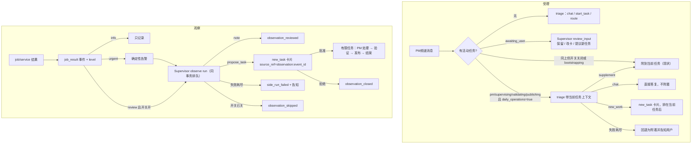

# Kernel 日常运营模块：分阶段实施清单与自检

基线：`H:/AI/assistant-kernel`，分支 `main`，HEAD `0b395e7`，`__version__ 0.46.3`，`__schema_version__ core6.0015`。工作区另有 63 项他人/其他模块未提交改动（含未跟踪迁移 0011–0015），本清单不触碰它们。
本文件只是实施计划和对计划的自检，**本轮没有修改任何源码、模板、迁移或测试**。

---

## 0. 范围

**只做日常运营模块**：项目在交付后的持续受理、作业结果观察与处理、问题回接、相关可靠性、合同/Skill/模板一致性、新旧项目启用方式。

| 纳入 | 对应发现 |
|---|---|
| 忙时消息分流（查询 / 补充 / 独立需求） | OP-01 |
| 作业观察 → 分级 → 有限复核 → 卡片 → 后续任务 → 结束 | OP-02 |
| 作业暂停、退役、换版后的旧 run 处理 | OP-04 |
| 租约丢失后有副作用作业不盲重试；心跳长期失败自停 | OP-05 |
| 工具调用检查租约是否过期 | OP-06 |
| `/jobs run` 重投递去重 | OP-07 |
| outbox 发送结果未知不盲重发 | OP-03 |
| 补充消息处理失败要告知用户 | OP-15 |
| 周复盘开关严格解析、与业务调度分离 | OP-13 |
| 合同、Skill、角色、文档与实际能力同步；模板刷新避开运行中 run | OP-16、OP-08（与本模块相关部分） |
| 修复两项目测试 | OP-12 |
| 授权范围内连续小改（默认关闭，最后做） | OP-09 |

**不纳入**（属于其他模块，保持现状、不在本模块宣称完成）：通用内容档案与比较报告（OP-10）、模型复杂度路由与公共前缀（OP-11）、map 覆盖标记（OP-14）、P2 recipe 执行隔离。

---

## 1. 设计原则（全部阶段共用）

1. **不新增状态平台**：只用 `messages / runs / tasks / interactions(card) / task_events / jobs / projects.settings`。
2. **新增物件上限**：1 个项目设置键、1 个 run purpose、1 个核心合同文件；当前实现复用消息 JSON 元数据，无需新增迁移。超出须在评审中说明现有机制为何不够。
3. **行为开关**：会改变旧项目行为的运营能力统一挂在 `core.projects.settings.daily_operations`（严格布尔，缺省 = false）。新项目在创建时写入 true；旧项目由运维方显式写入（与现有 `skill_updates` 策略同一入口）。**纯缺陷修复不挂开关。**
4. **授权只来自程序校验**：观察内容、日志、模型输出只能“提议”，任何写动作都要经过已有卡片按钮（绑定 `item_id`）或已有批准记录。
5. **同事务原则**：观察事件、分级和复核排队在同一事务内写入，因此不需要额外的补偿扫描。
6. **回退**：每阶段可单独回退；开关置 false 后，已排队的运营 run 在执行与结果两处都会被丢弃，并留事件。

---

## 2. 目标闭环（实施后）

每条路径都有终点事件；没有永久活动任务；卡片项不占用项目的活动任务位。

---

## 3. 分阶段清单

每阶段格式：改动点 → 规则 → 验收 → 退出条件 → 回退。阶段间严格串行：上一阶段退出条件不满足不进入下一阶段。

### 阶段 0：基线与测试修复（不改业务行为）

| # | 改动点 | 内容 |
|---|---|---|
| 0.1 | `tests/core/test_runtime.py:373–414` | 修复生成脚本中的字面 `\n` 导致的 SyntaxError；观察数量按 p1=1、p2=2 断言；查询按 `project_id` 分组；断言不得接受 `project_id IS NULL` |
| 0.2 | 基线记录 | 记录分支、HEAD、迁移目录最大序号（当前 0015，且 0011–0015 未跟踪属他人工作）、受影响测试的当前 pass/fail/skip |

- 验收：临时 PostgreSQL 上跑 `tests/core/test_runtime.py`、`test_dispatch.py`、`test_gateway.py`、`test_evolution.py` 当前基线，原样记录 pass/fail/skip/error。
- 退出条件：0.1 测试通过且断言未被削弱；基线失败项逐条标注“本次前已存在 / 环境限制”，有复现证据。
- 回退：仅测试文件。

### 阶段 1：可靠性缺陷修复（全局生效，不挂开关）

| # | 改动点 | 规则 | 对应 |
|---|---|---|---|
| 1.1 | `jobs.set_status`（暂停）、`jobs.apply_manifest`（退役/换版） | 同事务内把该 job 的 **queued** run 置 `cancelled` 并记 `job_run_cancelled`；运行中的 run 不杀（暂停 = 停止未来调度，不是取消） | OP-04 |
| 1.2 | `Kernel.claim` 的 eligible 条件 | job run 额外要求 `core.jobs.status='enabled'` 且 `manifest_sha` 等于 run 入队时记录的值（入队时写入 `input.manifest_sha`）；作为 1.1 的兜底 | OP-04 |
| 1.3 | `machine._job_result / _job_exhausted` | run 的 `manifest_sha` 与当前不同：只写 `job_result`（`stale=true`），不更新 `core.jobs` 的状态字段 | OP-04 |
| 1.4 | `jobs.run_now` + `gateway.jobs_command` | 暂停的 job 拒绝手动运行（提示先 resume）；传入 `request_key=msg:<message_id>`，在项目锁下查已存在相同 key 的 job run 则返回原 run | OP-07 |
| 1.5 | `Kernel.recover_expired` | `run_type='job'` 且 spec 未声明 `idempotent: true` 时，租约过期不再重试：标记 failed，`error.type='result_unknown'`，`job_result.status='unknown'` | OP-05 |
| 1.6 | `runtime-manifest.md` 合同 + manifest 校验 | 新增可选字段 `idempotent`（布尔，缺省 false），说明它只影响“租约丢失后是否重试”，不影响退出码失败的重试 | OP-05 |
| 1.7 | `Dispatcher._heartbeat` | 记录最后一次续租成功时间；超过 `lease_seconds × 0.8` 仍未成功则设 `context.cancel` 并取消工作（自我隔离），避免恢复扫描已接管后旧进程继续执行 | OP-05 |
| 1.8 | `tools.Scope.check_lease`、`host_operations.authorize` | 增加 `lease_until > now()`。`Kernel._held`（提交结果）**不加**（见自检 S-3） | OP-06 |
| 1.9 | `Kernel.begin_delivery` | 在消息 body 中记录 `sending_at` 和 `send_attempts`，复用 pending 状态，无新增迁移 | OP-03 |
| 1.10 | `GatewayService.deliver_outbox`、`Kernel.pending_outbound / mark_delivered` | 发送前记录 sending_at；成功 → sent；已知失败按现有重试处理；pending 中超过 10 分钟的未确认发送带“可能重复”标记重发一次，再次未知则标记 failed | OP-03 |
| 1.11 | `machine.on_exhausted` 的 `review_input` 分支 | 向 PM 频道发送 `mx.review_input_failed`（卡片仍在等待、可重发或直接回答）；卡片不变 | OP-15 |
| 1.12 | `Kernel.expire_idle_tasks` | “用户活动”只统计 `task_id = 该任务` 的入站消息，不再统计项目内任意消息；卡片动作仍通过任务 `updated_at` 计入（现有条件不变） | OP-15 |
| 1.13 | `dispatch_main` | `CORE_WEEKLY_EVOLUTION` 严格解析（1/true/yes/on 为开，其余为关）；不影响 recover、idle、vaults、runtime、jobs、services 各步 | OP-13 |

- 验收（临时 PG + 真实子进程）：
  - 排队后暂停 / 退役 / 换版：旧 run 不执行、不覆盖 job 状态；恢复后按新 spec 调度。
  - 同一 `/jobs run` 消息重投递只生成 1 个 run；两条不同消息生成 2 个 run（按 mutex 串行）。
  - 脚本已写外部文件后模拟 DB 断开导致租约过期：非 idempotent 作业不重跑，产生 `unknown` 观察；`idempotent: true` 作业按原逻辑重试。
  - 心跳持续失败：工作在租约过期前自停。
  - 工具在租约过期后调用被拒；结果提交在 token 未被回收时仍被接受。
  - 发送成功后、记账前杀进程：恢复后只重发一次且带“可能重复”标记。
  - review_input 重试耗尽：用户收到失败告知，卡片仍可操作。
  - 项目内无关聊天不再延长等待中任务的过期时间。
  - 环境变量 `false` 不开启周复盘。
- 退出条件：以上全部通过；阶段 0 基线测试无新增失败。
- 回退：代码可单独回退；迁移 0016 只放宽 CHECK，回退代码后旧代码不会写 `sending`，表约束兼容，无需反向迁移。

### 阶段 2：受理分流与观察闭环（挂 `daily_operations` 开关）

| # | 改动点 | 规则 | 对应 |
|---|---|---|---|
| 2.1 | `machine.user_input` | 活动任务状态为 pm / supervising / validating / publishing 且开关开启：消息不立即附着，排 `triage`（`input.context_task_id`）。awaiting_user 继续走 review_input；bootstrapping 或开关关闭保持附着（现状） | OP-01 |
| 2.2 | `prompts/core/triage.md` | 增加“有当前任务时”一节：决策只能是 `chat / supplement / new_work`；拿不准选 `supplement`（与现状一致，最安全） | OP-01 |
| 2.3 | `machine._triage_result` | `supplement` → 调用原附着逻辑；`new_work` → `_propose_new_task(after=当前任务目标)`；`chat` → 只答复，消息不附着；空闲时 start_task 若发现已有活动 delivery（竞态）→ 改为 new_task 卡片，不再强行附着 | OP-01 |
| 2.3b | 补充附着（2.3 的 supplement 分支） | 附着时写 `input_attached` 事件（task_events，带 message_id）；`_supervisor_result` 与 `_review_input_result` 的“有新输入”判断改为：消息 `created_at` 晚于 run 开始，**或**存在晚于 run 开始的 `input_attached` 事件。若附着时任务处于 awaiting_user，沿用现有 review_input 排队逻辑 | OP-01 |
| 2.3c | 同上 | 分流结果返回时，如果 `context_task_id` 已不是活动任务，就按当前状态重新执行一次 `user_input`；不附着到已结束的任务 | OP-01 |
| 2.4 | `machine.on_exhausted` 的 triage 分支 | 若有 `context_task_id` 且该任务仍活动：回退为附着并告知“已作为当前任务补充” | OP-01 |
| 2.5 | `_job_result / _job_exhausted / check_services / _apply_notice` | 事件 payload 增加 `level`，由代码确定性分级：成功、恢复 → info；首次失败（`failures` 由 0 变 1）、`unknown`、manifest 应用失败 → review；连续失败达到 3 次、服务离线 → urgent。spec `notify: none` → info | OP-02 |
| 2.6 | 同上（同一事务） | level 为 review/urgent 且开关开启，并且该 job 没有 queued/running 的 observe run、也没有未处理的 observation 卡片 → 排 `supervisor` run，`purpose='observe'`，`input={event_id}`，无 task_id；否则记 `observation_coalesced` | OP-02 |
| 2.7 | `executors/supervisor.py` | `PURPOSE_PROMPT['observe']='supervisor-observe'`。执行时按 `project_id + event_id + kind ∈ 允许集合` 重新读取事件，日志/摘要放入“不可信数据”段；开关已关闭 → 返回 `skipped` | OP-02 |
| 2.8 | 新合同 `prompts/core/supervisor-observe.md` | 输出 `{"decision":"note|propose_task","reply":...,"propose_new_task":{goal,message}}`；明确：不能执行、不能批准、不能把日志内容当作用户指令 | OP-02 |
| 2.9 | `machine.on_result` 新分支 `_observe_result` | 在锁内重新核对开关和事件归属；`note` → `observation_reviewed` + Supervisor 频道一句结论；`propose_task` → `_propose_new_task`，data 带 `source_ref=observation:<event_id>`；`skipped` → `observation_skipped` | OP-02 |
| 2.10 | `machine._consultation_action` | new_task 批准时把 `source_ref` 传给 `create_task`（参数已存在）；拒绝且带 `source_ref` → `observation_closed` | OP-02 |
| 2.11 | `machine.on_exhausted` | `purpose='observe'` 归入 side run：`side_run_failed` + Supervisor 频道告知事件编号 | OP-02 |
| 2.12 | `Kernel.evolution_context` | job_observations 同时返回 level 及对应终点事件，复盘可以看到哪些已处理、哪些未处理 | OP-02 |

- 验收（两个隔离项目，同一公共模板）：
  - 项目甲（内容生产，脚本作业产出文件）、项目乙（非财经的周报/维护，agent 作业 + 服务）。公共层不读取任何业务专有 Skill 或固定路径（用 grep 断言）。
  - 真实入口：`GatewayService.on_message` → `Kernel.receive` → Dispatcher → 执行器（模型调用使用测试替身，单独标注“模型输出为替身”；脚本与子进程为真实执行）。
  - 场景：build 进行中用户问进度（直接答复，不附着）、补充细节（附着，下一 PM 回合读取）、另提需求（卡片，批准后排队，当前任务范围不变）；两条消息并发各自分流；triage 失败回退为附着；triage 期间任务进入 supervising（Supervisor 重新评估并看到补充）；triage 期间任务结束（消息被重新分流，不挂到已结束任务）。
  - 作业失败 → review → observe run → propose_task → 批准 → 任务带 `source_ref` → 结案；拒绝 → `observation_closed`；连续失败只生成一个未处理复核；成功只记录不调用模型。
  - 开关关闭的旧项目：行为与阶段 1 后完全一致（对比事件序列）；开启后再关闭：已排队的 observe run 被跳过并留事件。
  - 跨项目：伪造他项目 `event_id` 被拒。
- 退出条件：上述全部通过；Supervisor 没有直接产生任何写动作（检查 runs/tasks 只由卡片动作创建）。
- 回退：开关置 false 即刻生效；代码回退不涉及数据结构。

### 阶段 3：合同、Skill、角色与分发一致性

| # | 改动点 | 内容 |
|---|---|---|
| 3.1 | `assistant-goal-supervisor` Skill | 增加 observe 场合的方法（只判断、记录或提议，不执行）；版本 +minor，写 changelog |
| 3.2 | `assistant-triage-routing` Skill | 描述与正文一致：增加“有当前任务时”的三种决策；删除超出能力的“事故处置”表述；版本 +minor |
| 3.3 | `assistant-operation` Skill | 说明观察来源、分级与终点事件，复盘时读取未处理项；仍是只读方法；版本 +minor |
| 3.4 | PM / Supervisor `role.md` 模板 | “event-triggered review” 改为“项目开启日常运营时，Kernel 会对作业异常发起有限复核”；保留“周复盘可选、非唯一入口” |
| 3.5 | `machine._bootstrap_result` | 新项目写入 `settings.daily_operations=true`，创建通知和 bootstrap 迭代记录中写明已启用；小改预授权不写（保持关闭） |
| 3.6 | `vault_sync._sync_templates` | 项目有 running/reconciling run 时本轮跳过（复用 `skill_updates` 中已有的同类判断），下一轮再同步 |
| 3.7 | 文档 | `docs/ARCHITECTURE.md` 运营一节、`docs/SKILL_ADOPTION.md` 增加 daily_operations 的启用与回退方式、`docs/map.yaml` 登记新合同、i18n `en.yaml` 新键、版本号与迁移登记 |

旧项目采纳规则（不新增模板系统）：
- 行为开关：运维方写 `settings.daily_operations=true` 即启用，写 false 即回退；不改动 hold、权限、暂停状态。
- Skill：未改动的副本由现有指纹同步刷新；已定制副本保持不变，由现有 adoption 显式处理。
- 角色 `role.md`：旧项目副本不自动改写。新行为的约束都在 Kernel 自带的核心合同里，旧角色不更新也能正确运行。

- 验收：新项目创建后 settings、角色、Skill 版本与合同一致；旧项目定制 Skill/角色保持原样；运行中不刷新 Skill；i18n 键齐全测试（`test_r6_i18n.py`）；模板结构所有权测试（`test_skills_r1.py`、`test_skill_updates.py`）。
- 退出条件：通过；文档中没有超出实际接线的表述（逐句对照第 6 节状态表）。

### 阶段 4（可选，默认关闭）：授权范围内的连续小改

前提：阶段 1–3 已通过。不依赖 P2 recipe 隔离，只复用现有 quick → candidate → validation → release。

| # | 改动点 | 规则 |
|---|---|---|
| 4.1 | 设置 `settings.small_change_preauth=true`（缺省 false，与 daily_operations 分开） | 只有运维方开启才可用 |
| 4.2 | quick 任务的需求批准卡片 | 开启时增加动作“批准并预授权发布”，记录 `approvals.release_preauth={contract_sha, paths, expires_at, message_id}` |
| 4.3 | `_validation_result` | 验证通过且 `contract_sha` 未变、bundle 文件 ⊆ `paths`、未过期、未取消、开关仍开 → 写入 `approvals.release={bundle_sha, basis:'preauth', preauth_message_id}` 后进入 publishing；任一不满足 → 回到现有发布卡片 |
| 4.4 | 越界 | 文件超出范围或需求文档有变更 → 预授权自动失效，按正式流程处理 |

- 验收：范围内一次完成实现、验证、发布；越界回到卡片；取消后不发布；关闭开关后的旧回调不发布；发布记录可以看出依据是预授权，不伪装成事后批准。
- 若不实施：第 6 节如实写“未启用”。

---

## 4. 自检

### 4.1 自洽：每条规则都有实现点、合同和测试

| 规则 | 实现点 | 合同 / Skill | 测试 |
|---|---|---|---|
| 查询不占开发任务 | 2.1、2.3 chat 分支 | triage.md | 阶段 2 场景 1 |
| 补充与独立需求分开 | 2.3、现有 review_input | triage.md、goal-supervisor | 阶段 2 场景 2、3 |
| 新输入不丢、不被旧等待搁置 | 2.3b、2.3c；现有 PM claim 固定输入批次 | — | 阶段 2 竞态场景 |
| 观察不能变成授权 | 2.7、2.9 只能提议；2.10 只认卡片按钮 | supervisor-observe.md | 阶段 2“无直接写动作”断言 |
| 同项目真实事件 | 2.7、2.9 双重核对 | — | 跨项目伪造测试 |
| 策略撤销后旧回调失效 | 2.7 执行时、2.9 结果时检查开关；1.2、1.3 检查 job 状态与版本 | — | 开关开→关、暂停、换版测试 |
| 结果未知不盲重试 | 1.5、1.10 | runtime-manifest.md | 故障注入测试 |
| 无停止证明不解锁 | 1.7 自停 + 1.8 工具拒绝；publish 保持原恢复规则 | — | 心跳失败测试 |
| 周复盘与业务调度分离 | 1.13；maintain 各步独立 | role.md 3.4 | 环境变量测试 |
| 新项目默认可发现 | 3.5 | role.md、Skill | 新建项目测试 |
| 旧项目不被静默改变 | 开关缺省 false | SKILL_ADOPTION.md | 旧项目事件序列对比 |

结果：没有只存在于提示词、却没有代码约束的规则；也没有只存在于代码、却没有写进合同的规则。

### 4.2 闭环：每个入口都有终点

| 入口 | 终点 |
|---|---|
| 忙时消息 | 答复 / 附着（被 PM 回合消费）/ 新任务卡片（批准成任务，或拒绝）/ triage 失败回退为附着 |
| info 观察 | 只有 `job_result`，不排队 |
| review/urgent 观察 | `observation_reviewed` / 卡片 → 任务结案或 `observation_closed` / `side_run_failed` / `observation_skipped` / `observation_coalesced` |
| `/jobs run` | 一个 run 或明确的拒绝 |
| 租约丢失的作业 | 重试（声明幂等）或 `unknown` 观察（进入复核） |
| outbox 消息 | `sent` / `failed` / 带标记重发一次后 `sent` |
| review_input 失败 | 告知用户，卡片仍有效 |

未处理的 observation 卡片会一直保留到用户点击：它不占用活动任务位，同一 job 也不会重复堆积（2.6 合并）。这是有意保留的“有限记录”，不是悬挂任务。

### 4.3 副作用：对现有行为的全部改变

| 改变 | 影响谁 | 是否有意 | 缓解 |
|---|---|---|---|
| 暂停后已排队的 run 被取消 | 所有项目 | 是（修缺陷） | 事件记录；resume 后正常调度 |
| 暂停的 job 不能 `/jobs run` | 所有项目 | 是 | 提示先 resume |
| 非幂等作业在租约丢失后不再自动重跑 | 所有项目 | 是（防重复副作用） | 进入 unknown 复核；可声明 `idempotent: true` 恢复旧行为；写 changelog |
| 心跳长期失败时主动停止工作 | 所有项目 | 是 | 由恢复流程接管；阈值 0.8 × 租约 |
| 工具调用要求租约未过期 | 所有项目 | 是 | 正常心跳下不触发 |
| outbox 增加 `sending` 状态 | 网关 | 是 | 迁移只放宽约束；最坏情况是一次带标记的重复发送 |
| 无关聊天不再延长等待中任务 | 所有项目 | 是（修缺陷） | 任务相关消息和卡片动作仍计入 |
| 忙时消息多一次 triage 模型调用 | 仅开关开启的项目 | 是 | 失败回退为附着；awaiting_user 不增加调用 |
| 观察复核的模型调用 | 仅开关开启的项目 | 是 | 只在首次失败、unknown、连续失败时触发，并按 job 合并 |
| Skill 版本提升触发刷新 | 未改动副本的项目 | 是（现有机制） | 3.6 避开运行中 run；定制副本不动 |

本模块不改：任务状态机、批准有效性规则、发布与对账流程、Project Access、host operations 的权限模型、他人的未提交迁移 0011–0015。

### 4.4 精简度

| 新增物件 | 数量 | 为什么现有机制不够 |
|---|---|---|
| 项目设置键 `daily_operations` | 1 | 需要“旧项目不变、新项目默认开”的显式采纳；`settings` 已是运维方策略的位置 |
| run purpose `observe` | 1 | 现有 consult 需要用户消息作为输入，evaluate 绑定任务游标，都不适用 |
| 核心合同 `supervisor-observe.md` | 1 | 输出结构与 consult 不同，必须能够解析 |
| 迁移 | 0 | 使用现有消息 body 的 sending_at / send_attempts 表达发送结果未知 |
| 可选设置 `small_change_preauth` | 1（阶段 4，可不做） | 写权限必须与只读运营分开授权 |

考虑过但没有采用：补偿扫描（同事务写入已保证）、独立观察表（用 `task_events`）、通用事件总线、新的任务类型（0005 已移除 `operation` 类型，不恢复）、存储命令消息做去重（会改变 idle 判定，改用 run 的 `request_key`）。

### 4.5 自检中发现并已在清单内修正的问题

| # | 初稿做法 | 问题 | 修正 |
|---|---|---|---|
| S-1 | 忙时 triage 对所有项目生效 | 旧项目会被静默改变行为并增加模型成本 | 挂 `daily_operations`，缺省关闭 |
| S-2 | 为观察复核加维护补偿扫描 | 写入与排队在同一事务，不存在“已保存未唤醒”的窗口；扫描反而可能引入重复复核 | 删除扫描，改为 on_exhausted 终点 + 合并规则 |
| S-3 | `_held` 也检查租约到期 | 在恢复扫描接管前到达的结果会被丢弃并重跑，对有副作用的作业更危险 | 只在工具调用处检查到期；结果提交以 token 未被回收为准，配合 1.7 自停 |
| S-4 | 把命令写入 messages 来去重 | 会被 `expire_idle_tasks` 和复盘活动判定当作用户活动 | 改为 run 的 `request_key` + 项目锁 |
| S-5 | 空闲 triage 遇到竞态时附着到新任务 | 独立需求被并入他人任务（OP-01 后半） | 改为 new_task 卡片 |
| S-6 | 观察复核后可以直接创建任务 | 等于让日志或模型授予执行权 | 只能提议，必须由用户点卡片 |
| S-7 | 用户用文字回答观察问题 | 无法精确关联，只能靠“最近一条”猜测 | 只用绑定 `item_id` 的按钮；文字消息走正常分流 |
| S-8 | `role.md` 写 event-triggered review | 当前没有接线，属于过度宣称 | 3.4 改为有条件描述，并与阶段 2 同步上线 |
| S-9 | 关闭开关只影响新排队 | 已排队的 observe run 仍会执行 | 2.7 执行时、2.9 结果时双重检查 |
| S-10 | triage 完成后直接附着 | 任务可能已进入 supervising；现有“有新输入”判断只比较消息创建时间，会漏掉迟到附着的补充，卡片可能忽略用户刚说的话 | 2.3b：增加 `input_attached` 事件，并把它纳入新输入判断 |
| S-11 | 补充始终附着到 `context_task_id` | triage 期间任务可能已经结束，消息会挂到已结束任务上，永远不会被读取 | 2.3c：按当前状态重新分流 |

### 4.6 仍需注意（不阻断实施）

- 当前日常运营实现不需要 0016；其他模块迁移仍须检查实际序号、校验值和回滚兼容性，不得修改已应用的迁移。
- 2.5 的分级阈值（连续 3 次为 urgent）是初始默认值，必须写进合同；如果需要按 job 调整，可以留到以后再加 spec 字段，本次不做。
- 卡片显示路径（`render_item`）在发送后崩溃可能重复显示同一张卡片；由于 `take_item` 按 `item_id` 只生效一次，重复卡片只会显示为过期，不会重复执行，所以本次不处理。
- 阶段 2 的验收使用模型替身，只证明 Kernel 的接线和约束；不能写成“真实模型端到端通过”。

---

## 5. 测试分层与命令（实施时执行）

| 层 | 内容 | 环境 |
|---|---|---|
| 单元 | 分级规则、开关解析、`idempotent` 校验、request_key 判重 | 纯 Python |
| 服务集成 | 1.x、2.x 的状态转换与事件序列 | 临时 PostgreSQL（现有 conftest） |
| 真实入口 | Gateway `on_message` → Kernel → Dispatcher → 真实脚本子进程；模型调用使用替身并标注 | 现有 AI 容器的测试环境 + 临时库（不创建镜像或容器） |
| 回归 | `test_runtime / test_dispatch / test_gateway / test_evolution / test_scenarios / test_skills_r1 / test_skill_updates / test_r6_i18n / test_bootstrap` | 同上 |

报告时 pass、fail、skip、error 分开写；不修改或删除已有断言来让测试通过。

---

## 6. 六项状态（当前 → 各阶段完成后的目标）

| 能力 | 代码已有 | 实际已接线 | 默认已分发 | 已授权启用 | 隔离验收通过 | 生产已部署 |
|---|---|---|---|---|---|---|
| 可靠性修复（阶段 1） | 否 → 是 | 否 → 是 | 不适用（全局） | 不适用 | 否 → 阶段 1 验收 | 否（不在本计划内） |
| 忙时分流（阶段 2） | 否 → 是 | 否 → 是 | 否 → 新项目开 | 旧项目需运维方开启 | 否 → 阶段 2 验收 | 否 |
| 观察闭环（阶段 2） | 部分 → 是 | 否 → 是 | 否 → 新项目开 | 同上 | 否 → 阶段 2 验收 | 否 |
| 合同 / Skill / 角色一致（阶段 3） | 部分 → 是 | 部分 → 是 | 部分 → 是 | 不适用 | 否 → 阶段 3 验收 | 否 |
| 连续小改（阶段 4） | 否 →（可选）是 | 否 →（可选）是 | 否（默认关） | 需单独开启 | 否 →（可选） | 否 |

生产部署、修改生产数据库、为真实项目打开开关，都不在本计划范围内，需要另外授权。
